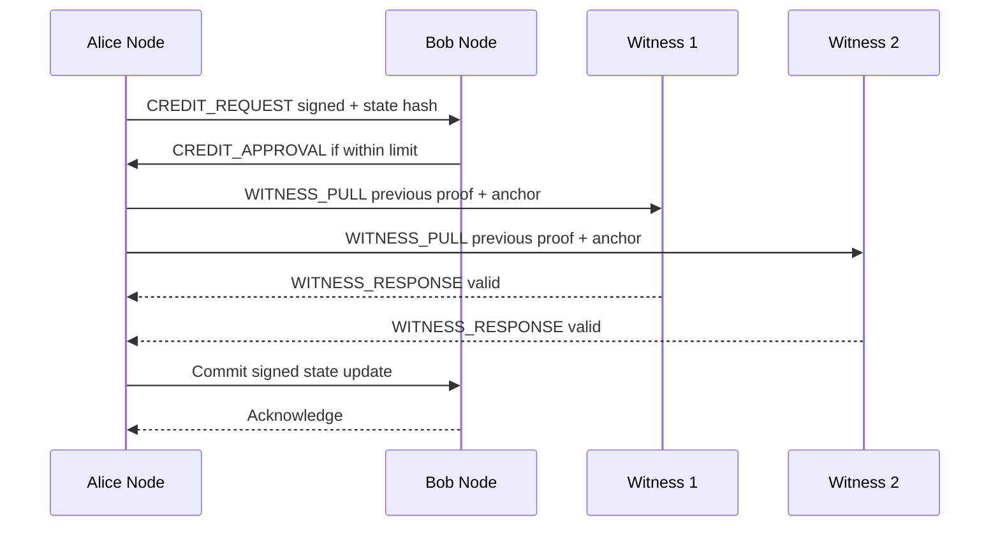
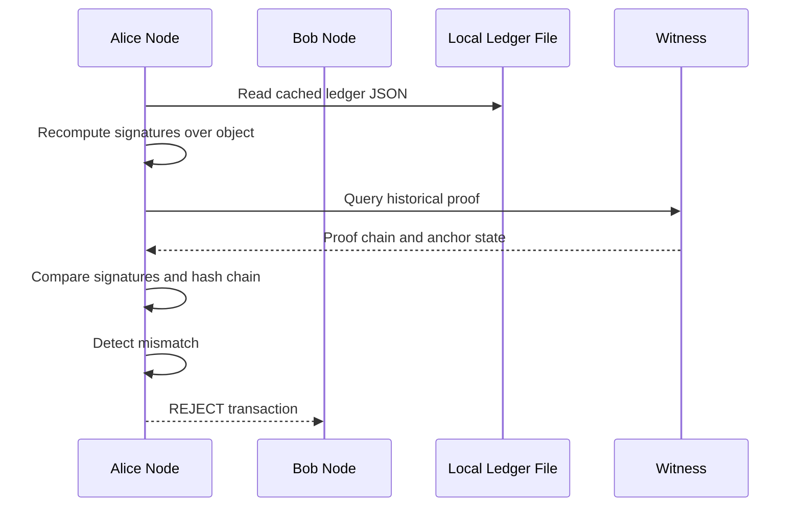
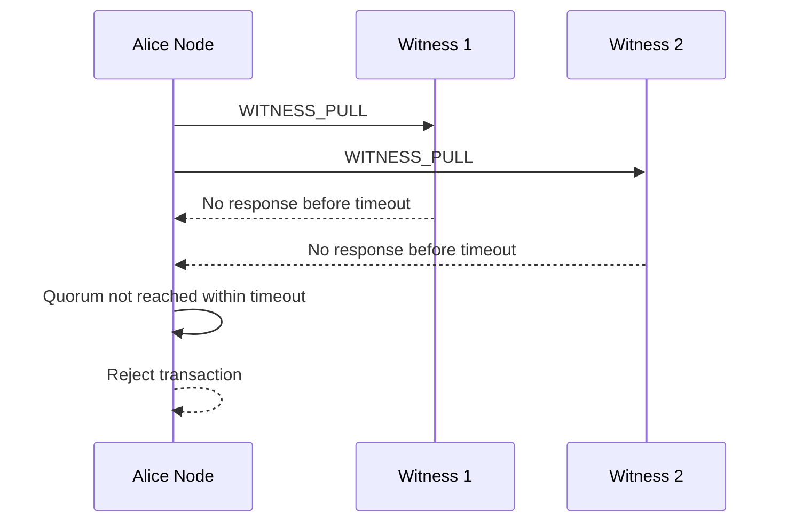
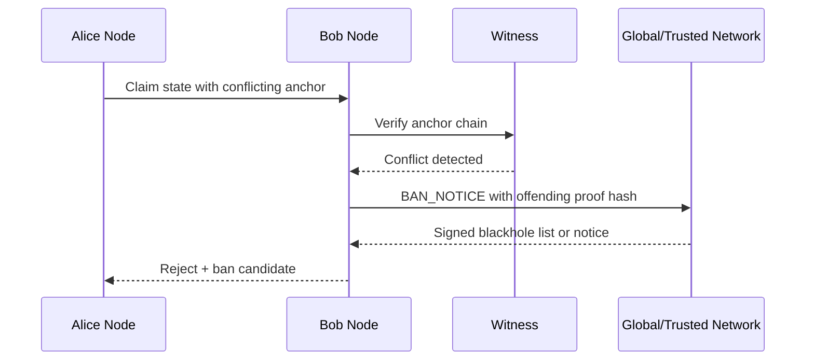

# Architecture

This document gives the high-level architecture for the Reticulum Mutual Credit System. The system is intentionally small, modular, and fail-closed.

## Overview

Each participant runs a local node that maintains:

- a persistent RNS identity
- a local ledger of bilateral credit lines
- a witness registry and reputation tracker
- an anchor history for tamper-evident checkpoints
- optional banlist and signed blackhole list handling

No global ledger is shared. Instead, each pair maintains a hash chain that records its mutual credit state across time.

## Core components

- `src/crypto.py`: wrappers around RNS identity and signature operations, nonce/counter handling, hash chain logic, and anchor computation
- `src/ledger.py`: balance math, limit enforcement, validation of pair state, and local accounting
- `src/witness.py`: witness selection, quorum verification, independence checks, and timeout logic
- `src/anchors.py`: anchor publication and verification against historical history
- `src/protocol.py`: message schema definitions and JSON serialization helpers
- `src/node.py`: network adapter around `RNS.Link`, announcements, and fail-closed transaction gates
- `src/banlist.py`: signed ban propagation and local enforcement
- `src/reputation.py`: local viewer-relative trust metrics
- `src/cli.py`: command-line interface

## Sequence diagrams

### 1) Happy path with quorum = 2

### 2) Tampered JSON detection

### 3) Witness timeout -> rejection

### 4) Anchor conflict -> ban propagation

## Design constraints

- no blockchain
- no trusted central bank
- strict witness independence
- configurable quorum and timeouts
- fail-closed behavior required in every acceptance gate
